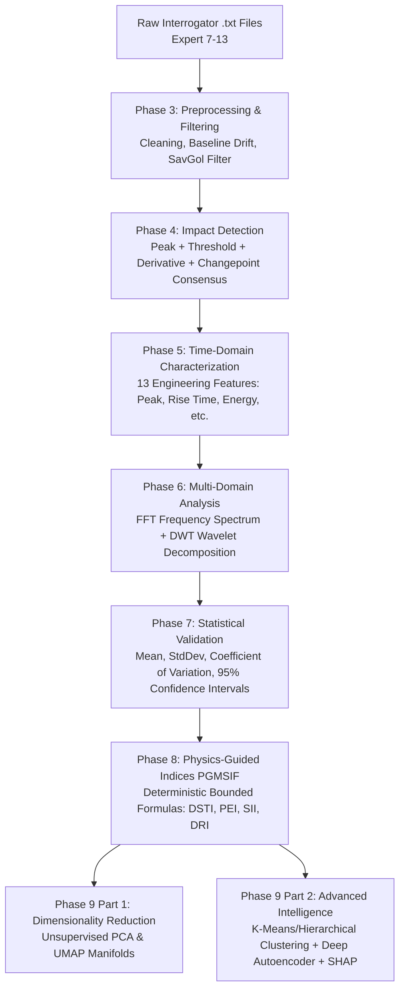
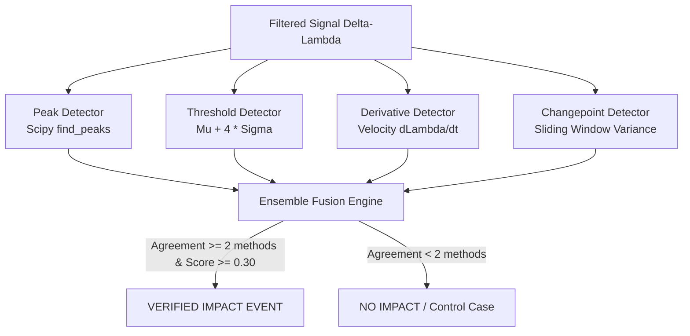

# 🔬 Fiber Bragg Grating (FBG) Impact Analysis & PGMSIF Framework
### Physics-Guided Multi-Domain Signal Intelligence Framework for Structural Health Monitoring

---

## 🌟 Welcome! Start Here (For Beginners)

Welcome to the **FBG Impact Analysis** repository! If you are new to programming, signal processing, or optical sensors, **do not worry**—this document was written specifically for you.

Every concept, piece of math, and line of code in this repository is explained here step by step in plain English, with real-world analogies, visual diagrams, and practical examples.

---

## 📑 Table of Contents

1. [What is This Project About? (The Big Picture)](#1-what-is-this-project-about-the-big-picture)
   - [What is an FBG Sensor?](#what-is-an-fbg-sensor)
   - [Why Analyze Mechanical Impacts?](#why-analyze-mechanical-impacts)
   - [Why Does Sensor Packaging Matter? (Bare vs Copper vs Steel)](#why-does-sensor-packaging-matter-bare-vs-copper-vs-steel)
2. [Experimental Setup & Dataset](#2-experimental-setup--dataset)
   - [The RVCE Mechanical Strain Experiments](#the-rvce-mechanical-strain-experiments)
   - [Sensor Channel Mapping](#sensor-channel-mapping)
   - [Raw Interrogator File Structure](#raw-interrogator-file-structure)
3. [Repository Folder Structure](#3-repository-folder-structure)
4. [End-to-End Pipeline Architecture (Phases 3 to 9)](#4-end-to-end-pipeline-architecture-phases-3-to-9)
5. [Deep Dive: Step-by-Step Code & Coding Concepts](#5-deep-dive-step-by-step-code--coding-concepts)
   - [Foundations: Configuration (`src/config.py`)](#foundations-configuration-srcconfigpy)
   - [Phase 3: Preprocessing, Baseline Drift & Filtering Benchmark](#phase-3-preprocessing-baseline-drift--filtering-benchmark)
   - [Phase 4: Multi-Method Ensemble Impact Detection](#phase-4-multi-method-ensemble-impact-detection)
   - [Phase 5: Time-Domain Engineering Signal Characterization](#phase-5-time-domain-engineering-signal-characterization)
   - [Phase 6: Multi-Domain Time-Frequency Analysis (FFT & Wavelets)](#phase-6-multi-domain-time-frequency-analysis-fft--wavelets)
   - [Phase 7: Statistical Validation & Confidence Intervals](#phase-7-statistical-validation--confidence-intervals)
   - [Phase 8: Physics-Guided Engineering Indices (PGMSIF)](#phase-8-physics-guided-engineering-indices-pgmsif)
   - [Phase 9 Part 1: Dimensionality Reduction (PCA & UMAP)](#phase-9-part-1-dimensionality-reduction-pca--umap)
   - [Phase 9 Part 2: Clustering, Neural Autoencoder & Explainability](#phase-9-part-2-clustering-neural-autoencoder--explainability)
6. [Key Scientific Findings: Bare vs Copper vs Steel](#6-key-scientific-findings-bare-vs-copper-vs-steel)
7. [How to Run the Code (Beginner's Step-by-Step Guide)](#7-how-to-run-the-code-beginners-step-by-step-guide)
8. [Beginner's Glossary of Technical Terms](#8-beginners-glossary-of-technical-terms)
9. [Git Branch & Collaboration Guide](#9-git-branch--collaboration-guide)

---

## 1. What is This Project About? (The Big Picture)

### What is an FBG Sensor?

**FBG** stands for **Fiber Bragg Grating**. 
* Imagine a very thin strand of glass (an optical fiber), thinner than a human hair (~125 micrometers in diameter).
* Inside the core of this glass fiber, microscopic periodic microscopic ripples (gratings) are etched using ultraviolet lasers.
* When broad-spectrum light is sent down the fiber, these ripples act like a selective mirror: they reflect back **one specific color (wavelength)** called the **Bragg wavelength ($\lambda_B$)**, while letting all other wavelengths pass straight through.

The fundamental formula governing an FBG sensor is:

$$\lambda_B = 2 \cdot n_{\text{eff}} \cdot \Lambda$$

Where:
* $\lambda_B$ = Reflected Bragg wavelength (measured in nanometers, e.g., $\sim 1540\text{ nm}$ to $1560\text{ nm}$).
* $n_{\text{eff}}$ = Effective refractive index of the optical fiber core.
* $\Lambda$ (Lambda) = Physical grating pitch (spacing between the microscopic ripples).

### Why Analyze Mechanical Impacts?

When a structure (like an aircraft wing, a bridge girder, or a composite panel) gets hit by an object:
1. The structure vibrates and deforms, creating **mechanical strain** ($\varepsilon$).
2. Because the optical fiber is bonded to the structure, the fiber stretches or compresses.
3. When the fiber stretches, the spacing between the ripples ($\Lambda$) increases!
4. This causes the reflected wavelength ($\lambda_B$) to shift to a higher or lower value ($\Delta \lambda$).
5. An optical interrogator device reads this wavelength shift at high speed ($50\text{ times per second}$, i.e., $50\text{ Hz}$).

By measuring **$\Delta\lambda(t)$ over time**, we can determine:
* Exactly **when** an impact occurred.
* How **severe** the impact was.
* How the host material **absorbed or dissipated** the energy.

### Why Does Sensor Packaging Matter? (Bare vs Copper vs Steel)

A bare glass fiber is extremely fragile—it snaps easily in industrial environments! Therefore, engineers encase the fiber inside protective sleeves or coatings made of different materials (**packaging**).

However, packaging introduces a trade-off:
* Does the protective sleeve cushion the impact so much that the sensor cannot feel the strain?
* Or does a stiff sleeve transmit the impact wave cleanly?

This project compares **three physical sensor configurations** tested side by side:

| Sensor | Packaging Material | Mechanical Characteristics | Expected Behavior |
| :--- | :--- | :--- | :--- |
| **FBG2** | **Bare (Silica Glass)** | Unprotected, pure silica glass | Most sensitive to direct surface strain, but vulnerable to breakage and environmental noise. |
| **FBG1** | **Copper Packaged** | Ductile, high thermal/strain conductivity | Excellent strain transfer; ductile deformation creates high peak response and rich frequency dynamics. |
| **FBG3** | **Steel Packaged** | High stiffness, high elastic modulus ($E \approx 200\text{ GPa}$) | Extremely rugged; shields against high-frequency shock, producing damped, smooth response curves. |

---

## 2. Experimental Setup & Dataset

### The RVCE Mechanical Strain Experiments

The experimental data was acquired at the **RVCE (Rashtreeya Vidyalaya College of Engineering)** mechanical testing facility.
Controlled impact tests were performed on a structural test plate equipped with the three FBG sensors simultaneously.

Seven experimental trials are analyzed in this project:
* `Expert 7`
* `Expert 8`
* `Expert 9`
* `Expert 10`
* `Expert 11`
* `Expert 12`
* `Expert 13`

Each experiment records all 3 FBG channels across hundreds to thousands of time samples.

### Sensor Channel Mapping

In this repository, the hardware channels are mapped as follows (defined in `src/config.py`):

```python
MATERIAL_MAP = {
    "FBG1": "Copper",
    "FBG2": "Bare",
    "FBG3": "Steel"
}
```

* **Sampling Frequency ($f_s$):** $50.0\text{ Hz}$ (50 readings per second)
* **Sampling Interval ($\Delta t$):** $0.02\text{ seconds}$ ($1 / 50\text{ s}$)
* **Baseline Window:** The first $100\text{ samples}$ ($2.0\text{ seconds}$) of every test are recorded before any impact occurs to measure quiescent noise.

### Raw Interrogator File Structure

The raw data comes directly from the Micron Optics / optical interrogator as text files (e.g., `RVCE mechanical strain expert10.20260327121942.txt`).

A typical raw file contains:
1. Header metadata lines (interrogator model, calibration constants, date/time).
2. Tab-separated or whitespace-separated columns:
   - Column 0: `time` (seconds or timestamp)
   - Column 1: `channel_id` (optical channel)
   - Column 2: `peak_count` (detected spectral peaks)
   - Column 3-4: Internal diagnostic flags
   - Column 5: `FBG1` wavelength (in nm, approx. $\sim 1546\text{ nm}$)
   - Column 6: `FBG2` wavelength (in nm, approx. $\sim 1550\text{ nm}$)
   - Column 7: `FBG3` wavelength (in nm, approx. $\sim 1554\text{ nm}$)

---

## 3. Repository Folder Structure

Here is how the project files are organized:

```text
FBG_Impact_Analysis/
├── data/
│   ├── raw_data/                       # Original raw interrogator text files
│   └── processed/
│       ├── final_phase_input/          # Clean, Savitzky-Golay filtered CSVs from Phase 3
│       └── ...                         # Intermediate filtered datasets (Butterworth, Median, etc.)
│
├── src/                                # Core reusable Python modules
│   ├── config.py                       # Master parameters (sampling rate, channels, thresholds)
│   ├── feature_extraction.py           # Extracts 13 engineering time-domain features (Phase 5)
│   ├── engineering_features.py         # Helper mathematical routines for feature extraction
│   ├── comparison_analysis.py          # Material comparison tables and plotting routines
│   ├── analysis/
│   │   └── noise_analysis.py           # Computes SNR (Signal-to-Noise) and RMSE
│   ├── filtering/
│   │   ├── savitzky_golay.py           # Savitzky-Golay digital filter
│   │   ├── butterworth.py              # Butterworth lowpass digital filter
│   │   ├── moving_average.py           # Simple moving average boxcar filter
│   │   ├── median.py                   # Median filter for outlier rejection
│   │   └── filter_comparison.py        # Runs all 4 filters side-by-side
│   ├── io/
│   │   ├── data_loader.py              # Reads and parses raw interrogator files
│   │   └── save_processed_data.py      # Standardized CSV exporter
│   ├── phase_6/
│   │   ├── fft_analysis.py             # Fast Fourier Transform (FFT) features
│   │   └── wavelet_analysis.py         # Discrete Wavelet Transform (DWT db4) features
│   ├── preprocessing/
│   │   ├── cleaning.py                 # Checks NaN, inf, and corrupt rows
│   │   ├── baseline.py                 # Baseline drift subtraction (first 100 samples)
│   │   ├── wavelength.py               # Computes Delta-Lambda (wavelength shift)
│   │   └── preprocessing_pipeline.py   # Complete Phase 3 preprocessing chain
│   └── visualization/
│       └── plots.py                    # Filter comparison and wavelength shift plots
│
├── changepoint_detection.py            # Phase 4 detector: sliding variance change-point
├── derivative_detection.py             # Phase 4 detector: rate-of-change (velocity) detector
├── peak_detection.py                   # Phase 4 detector: prominence and local maxima
├── threshold_detection.py              # Phase 4 detector: standard deviation noise threshold
│
├── phase3_main.py                      # Phase 3 Orchestrator: Preprocessing & Filter Benchmark
├── phase4.py                           # Phase 4 Orchestrator: Multi-Method Ensemble Detection
├── phase5.py                           # Phase 5 Orchestrator: 13 Engineering Features Extraction
├── phase6.py                           # Phase 6 Orchestrator: FFT & Wavelet Multi-Domain Analysis
├── phase7.py                           # Phase 7 Orchestrator: Statistical Validation & CIs
├── phase8.py                           # Phase 8 Orchestrator: PGMSIF Novel Engineering Indices
├── phase9_pca.py                       # Phase 9 Part 1A: Principal Component Analysis (PCA)
├── phase9_umap.py                      # Phase 9 Part 1B: UMAP Non-Linear Manifold Projection
├── phase9_clustering.py                # Phase 9 Part 2A: K-Means, Hierarchical & DBSCAN
├── phase9_autoencoder.py               # Phase 9 Part 2B: PyTorch Deep Neural Autoencoder
├── phase9_explainability.py            # Phase 9 Part 2C: Random Forest & SHAP Value Analysis
├── phase9_part2.py                     # Phase 9 Part 2 Master Runner
│
├── results/                            # All generated CSV tables, markdown reports, and PNG plots
│   ├── phase3/                         # Filter comparison plots and SNR metrics
│   ├── phase4/                         # Impact detection charts and method agreements
│   ├── phase5/                         # 13-feature tables, boxplots, radar plots
│   ├── phase6/                         # Multi-domain FFT & wavelet feature CSVs
│   ├── phase7/                         # Statistical summaries, CV heatmaps, 95% CIs
│   ├── phase8/                         # DSTI, PEI, SII, DRI index scores and radar charts
│   └── phase9/                         # PCA, UMAP, Autoencoder, Clustering, and SHAP results
│
├── requirements.txt                    # Python package dependencies
└── README.md                           # This comprehensive guide!
```

---

## 4. End-to-End Pipeline Architecture (Phases 3 to 9)

The project executes sequentially in **nine progressive scientific phases**. Each phase solves a specific problem and feeds verified data into the next phase:



### High-Level Summary Table of All Phases

| Phase | Main Script | Input | Output | Purpose in Plain English |
| :---: | :--- | :--- | :--- | :--- |
| **3** | `phase3_main.py` | Raw `.txt` files | Filtered CSVs in `data/processed/` | Cleans sensor noise and computes wavelength shifts $\Delta\lambda$. |
| **4** | `phase4.py` | Filtered CSVs | `results/phase4/` (CSVs & plots) | Detects exactly when an impact happened using 4 voting methods. |
| **5** | `phase5.py` | Phase 4 events + CSVs | `results/phase5/` (13 features) | Calculates physical metrics (peak height, rise time, recovery time). |
| **6** | `phase6.py` | Phase 4 events + CSVs | `results/phase6/` (24 features) | Analyzes vibrations using FFT frequencies and Wavelet energies. |
| **7** | `phase7.py` | Phase 5 & 6 CSVs | `results/phase7/` (stats & CIs) | Computes averages, uncertainties, and 95% confidence intervals. |
| **8** | `phase8.py` | Phase 5, 6 & 7 CSVs | `results/phase8/` (PGMSIF indices) | Calculates 4 novel engineering scores (DSTI, PEI, SII, DRI). |
| **9.1**| `phase9_pca.py`<br>`phase9_umap.py` | Phase 5, 6 & 8 CSVs | `results/phase9/pca/`<br>`results/phase9/umap/` | Compresses 24 features into 2D plots using PCA & UMAP. |
| **9.2**| `phase9_part2.py` | Phase 5, 6 & 8 CSVs | `results/phase9/clustering/`<br>`results/phase9/autoencoder/`<br>`results/phase9/explainability/` | Groups materials with AI clustering, Deep Autoencoders, and SHAP explanations. |

---

## 5. Deep Dive: Step-by-Step Code & Coding Concepts

Let us now walk through every single file and understand how the code works from the ground up!

---

### Foundations: Configuration (`src/config.py`)

In professional software development, you **never hardcode numbers** inside random functions. Instead, you keep all settings in one central file.

In [`src/config.py`](file:///C:/Users/AdithyaP/.gemini/antigravity/scratch/FBG_Impact_Analysis/src/config.py):
* `SAMPLING_FREQUENCY = 50.0`: The interrogator records 50 samples each second.
* `SAMPLING_INTERVAL = 0.02`: The time between any two samples is $1/50 = 0.02\text{ seconds}$.
* `BASELINE_SAMPLES = 100`: The first 100 data points ($2.0\text{ seconds}$) are used to measure resting noise.
* `MATERIAL_MAP`: Maps hardware channel `FBG1` to Copper, `FBG2` to Bare, and `FBG3` to Steel.
* Detector thresholds and fusion weights:
  ```python
  PEAK_WEIGHT = 0.30
  THRESHOLD_WEIGHT = 0.30
  DERIVATIVE_WEIGHT = 0.25
  CHANGE_POINT_WEIGHT = 0.15
  ```
  These weights sum to $1.0$. When multiple detectors agree, their weights are added together to form an evidence score!

---

### Phase 3: Preprocessing, Baseline Drift & Filtering Benchmark

#### 1. Loading the Data (`src/io/data_loader.py`)
Raw files from interrogators often contain messy headers or irregular spaces.
* Function: `load_fbg_data(file_path)`
* How it works: Uses Pandas `pd.read_csv()` with a regular expression separator `\s+` (whitespace). It skips initial metadata rows, extracts only columns `[time, FBG1, FBG2, FBG3]`, and checks that the data is numeric.

#### 2. Cleaning and Outlier Removal (`src/preprocessing/cleaning.py`)
* Optical sensors sometimes experience momentary laser beam dropouts, causing `NaN` (Not a Number) or infinite values.
* How it works: `clean_fbg_data()` inspects each column. If tiny gaps exist, it interpolates linearly; if major corruption exists, it flags the row.

#### 3. Wavelength Shift Calculation (`src/preprocessing/wavelength.py`)
* Raw FBG values are absolute wavelengths (e.g., $1546.321\text{ nm}$).
* Absolute numbers are difficult to compare because each sensor was manufactured with a slightly different resting wavelength.
* We want the **relative shift** ($\Delta\lambda$):
  $$\Delta\lambda(t) = \lambda(t) - \lambda_{\text{initial}}$$
* The initial wavelength $\lambda_{\text{initial}}$ is calculated as the mean of the first 100 baseline samples.
* Now, when there is no strain, $\Delta\lambda = 0.0\text{ nm}$. When an impact hits, $\Delta\lambda$ spikes!

#### 4. Baseline Drift Correction (`src/preprocessing/baseline.py`)
* Over long tests, ambient room temperature can warm up or cool down the fiber. Temperature causes slow, gradual changes in wavelength (thermal drift).
* How it works: The code fits a linear polynomial or subtracts the initial baseline mean from the entire signal so the signal rests precisely on the zero-axis.

#### 5. Multi-Filter Benchmark (`src/filtering/`)
Raw signals have high-frequency electrical jitter. Which digital filter removes the noise without distorting the real impact peak?
Four filters are implemented:
1. **Butterworth Lowpass Filter** ([`butterworth.py`](file:///C:/Users/AdithyaP/.gemini/antigravity/scratch/FBG_Impact_Analysis/src/filtering/butterworth.py)):
   - Standard 4th-order lowpass filter designed using `scipy.signal.butter`.
   - Smooths out frequencies above the cutoff, but can round off sharp impact peaks.
2. **Savitzky-Golay Filter** ([`savitzky_golay.py`](file:///C:/Users/AdithyaP/.gemini/antigravity/scratch/FBG_Impact_Analysis/src/filtering/savitzky_golay.py)):
   - Slides a window of $11\text{ points}$ and fits a 3rd-degree polynomial to the data.
   - **Why it wins:** Because it fits a polynomial curve, it preserves the high, narrow peak of an impact while wiping out random high-frequency fluctuations!
3. **Moving Average Filter** ([`moving_average.py`](file:///C:/Users/AdithyaP/.gemini/antigravity/scratch/FBG_Impact_Analysis/src/filtering/moving_average.py)):
   - Replaces each point with the average of its neighbors. Simple, but delays and broadens peaks.
4. **Median Filter** ([`median.py`](file:///C:/Users/AdithyaP/.gemini/antigravity/scratch/FBG_Impact_Analysis/src/filtering/median.py)):
   - Excellent at eliminating single-point salt-and-pepper spikes, but introduces flat staircases on smooth curves.

#### 6. Noise Analysis (`src/analysis/noise_analysis.py`)
Computes two key performance indicators:
* **SNR (Signal-to-Noise Ratio in decibels):**
  $$\text{SNR}_{\text{dB}} = 10 \cdot \log_{10}\left(\frac{\text{Variance}(\text{Signal})}{\text{Variance}(\text{Noise})}\right)$$
  Higher SNR means a clearer, cleaner signal!
* **RMSE (Root Mean Square Error):** Measures how closely the filtered signal tracks the raw signal without introducing artificial distortions.

**Phase 3 Conclusion:** The Savitzky-Golay filtered signals are selected and saved into `data/processed/final_phase_input/` to serve as the gold-standard inputs for all subsequent phases.

---

### Phase 4: Multi-Method Ensemble Impact Detection

How can computer code know whether a spike in the signal is a genuine physical impact or just someone bumping a table?
Phase 4 solves this using an **ensemble voting system** of four independent algorithms:



1. **Peak Detection ([`peak_detection.py`](file:///C:/Users/AdithyaP/.gemini/antigravity/scratch/FBG_Impact_Analysis/peak_detection.py)):**
   - Uses `scipy.signal.find_peaks` with prominence criteria.
   - Finds local maxima that stand out significantly above surrounding valleys.
2. **Threshold Detection ([`threshold_detection.py`](file:///C:/Users/AdithyaP/.gemini/antigravity/scratch/FBG_Impact_Analysis/threshold_detection.py)):**
   - Computes baseline standard deviation $\sigma_{\text{baseline}}$.
   - Triggers when $|\Delta\lambda(t)| > 4.0 \times \sigma_{\text{baseline}}$.
3. **Derivative Detection ([`derivative_detection.py`](file:///C:/Users/AdithyaP/.gemini/antigravity/scratch/FBG_Impact_Analysis/derivative_detection.py)):**
   - Computes discrete rate of change (strain velocity): $\frac{\Delta\lambda[i] - \Delta\lambda[i-1]}{\Delta t}$.
   - Impacts produce violent, near-instantaneous slope changes that easily exceed steady vibrations.
4. **Change-point Detection ([`changepoint_detection.py`](file:///C:/Users/AdithyaP/.gemini/antigravity/scratch/FBG_Impact_Analysis/changepoint_detection.py)):**
   - Slides a window of 20 samples and tracks local variance.
   - When the signal transitions from quiescent baseline to impact vibration, the variance jumps by orders of magnitude.

#### Consensus & Fusion Rules:
* If $\ge 2$ independent detectors agree within a tolerance window of 5 samples ($0.10\text{ s}$), the event is declared an **IMPACT**.
* If fewer than 2 detectors trigger, it is classified as **NO IMPACT**.
* Out of 21 sensor recordings (7 tests $\times$ 3 sensors), Phase 4 verified **12 IMPACT events** and **9 NO IMPACT control events**.

---

### Phase 5: Time-Domain Engineering Signal Characterization

In Phase 5 ([`phase5.py`](file:///C:/Users/AdithyaP/.gemini/antigravity/scratch/FBG_Impact_Analysis/phase5.py)), we extract **13 quantitative engineering features** from the verified impact waveform:

```text
       Peak Shift
          /\
         /  \
        /    \       <--- Recovery Phase
       /      \___________ Residual Shift
      /                   \
     |<-Rise->|           |
       Time
```

1. **`peak_shift_abs` ($\text{nm}$):** Maximum absolute wavelength deviation during the impact:
   $$\text{Peak Shift} = \max |\Delta\lambda(t)|$$
2. **`residual_shift_abs` ($\text{nm}$):** Permanent plastic deformation remaining after the impact vibrations die down.
3. **`rise_time_seconds` ($\text{s}$):** Time taken for the signal to shoot up from $10\%$ to $90\%$ of peak amplitude (measures shock wave sharpness).
4. **`recovery_time_seconds` ($\text{s}$):** Time taken to settle back down from peak to within $20\%$ of baseline (measures material damping).
5. **`peak_width_seconds` ($\text{s}$):** Full duration of the main impact pulse.
6. **`max_slope_abs` ($\text{nm/s}$):** Maximum velocity of deformation ($\max |d\Delta\lambda/dt|$).
7. **`rms` ($\text{nm}$):** Root Mean Square energy of the waveform:
   $$\text{RMS} = \sqrt{\frac{1}{N} \sum_{i=1}^N (\Delta\lambda_i)^2}$$
8. **`signal_energy` ($\text{nm}^2\cdot\text{s}$):** Total energy under the squared curve:
   $$E = \int [\Delta\lambda(t)]^2 \, dt \approx \sum (\Delta\lambda_i)^2 \cdot \Delta t$$
9. **`peak_to_peak` ($\text{nm}$):** Total vertical excursion: $\max(\Delta\lambda) - \min(\Delta\lambda)$.
10. **`variance` ($\text{nm}^2$):** Statistical variance of the vibration signal.
11. **`std_dev` ($\text{nm}$):** Standard deviation ($\sqrt{\text{variance}}$).
12. **`entropy` (bits):** Shannon entropy measuring the complexity/randomness of the waveform.
13. **`auc_abs` ($\text{nm}\cdot\text{s}$):** Area Under the absolute Curve ($\int |\Delta\lambda(t)| \, dt$).

> **Important Beginner Rule:** If a sensor recording was classified as **NO IMPACT**, impact-specific metrics (like rise time or peak width) are meaningless and set to zero/NaN. Baseline noise metrics (`baseline_nm`, `noise_std_nm`) are computed for all recordings.

---

### Phase 6: Multi-Domain Time-Frequency Analysis (FFT & Wavelets)

Time-domain features tell us **how big** the impact was. Multi-domain features tell us **how fast it vibrated** and **where the vibrational energy went**.

#### 1. Fast Fourier Transform (FFT) ([`src/phase_6/fft_analysis.py`](file:///C:/Users/AdithyaP/.gemini/antigravity/scratch/FBG_Impact_Analysis/src/phase_6/fft_analysis.py))
The Fourier Transform converts a time signal into its constituent frequencies:
* **Dominant Frequency ($f_{\text{dom}}$):** The frequency (in Hz) that contains the highest power peak.
* **Spectral Energy:** Sum of squared Fourier amplitudes: $\sum |X(f)|^2$.
* **Spectral Centroid:** The "center of mass" of the frequency spectrum (indicates whether vibrations are predominantly low-pitched or high-pitched):
  $$f_{\text{centroid}} = \frac{\sum f \cdot |X(f)|}{\sum |X(f)|}$$
* **Spectral Entropy:** Measures how spread out the frequencies are (pure sine wave = 0 entropy; noisy white shock = high entropy).
* **Bandwidth:** The spread/width of frequencies around the spectral centroid.

#### 2. Discrete Wavelet Transform (DWT) ([`src/phase_6/wavelet_analysis.py`](file:///C:/Users/AdithyaP/.gemini/antigravity/scratch/FBG_Impact_Analysis/src/phase_6/wavelet_analysis.py))
FFT tells you which frequencies exist, but **not when they occurred**. Because an impact is a sudden, brief transient, wavelets are mathematically superior!
* Uses **Daubechies 4 (`db4`)** wavelets at decomposition level 4 via `pywt.wavedec`.
* Decomposes the signal into:
  - **Approximation Coefficients ($A_4$):** Low-frequency structural bending dynamics.
  - **Detail Coefficients ($D_1, D_2, D_3, D_4$):** High-frequency acoustic emission and stress wave ripples.
* Features extracted:
  - `Approximation_Energy` ($E_A$)
  - `Detail_Energy` ($E_D$)
  - `Wavelet_Energy` ($E_{\text{total}} = E_A + E_D$)
  - `Wavelet_Entropy`
  - `Detail_Approx_Ratio` ($E_D / E_A$): Quantifies the proportion of high-frequency stress vs low-frequency flexure.

Together with Phase 5, this forms a rich **24-dimensional feature vector** for every impact event!

---

### Phase 7: Statistical Validation & Confidence Intervals

In engineering, you can never rely on a single data point. You must prove that your results are consistent across multiple trials!
Phase 7 ([`phase7.py`](file:///C:/Users/AdithyaP/.gemini/antigravity/scratch/FBG_Impact_Analysis/phase7.py)) groups the extracted features by packaging material (**Bare**, **Copper**, **Steel**) and computes:

1. **Sample Mean ($\mu$):**
   $$\mu = \frac{1}{n}\sum_{i=1}^n x_i$$
2. **Standard Deviation ($\sigma$):** Spread of the data points around the mean.
3. **Coefficient of Variation (CV):**
   $$\text{CV} = \frac{\sigma}{\mu}$$
   CV is dimensionless and tells us the **reproducibility** of the sensor:
   - Low CV ($< 0.20$): Highly repeatable sensor response.
   - High CV ($> 0.60$): Sensitive to boundary conditions or variable contact dynamics.
4. **95% Confidence Interval (CI):**
   Using Student's $t$-distribution with $n - 1$ degrees of freedom:
   $$\text{CI}_{95\%} = \mu \pm t_{0.025, \, n-1} \cdot \frac{\sigma}{\sqrt{n}}$$
   This gives the exact range within which the true physical value lies with 95% certainty.

---

### Phase 8: Physics-Guided Engineering Indices (PGMSIF)

Why not just throw the data into a machine learning model?
With small sample sizes in physical testing, complex black-box neural networks can overfit and hallucinate. 
In Phase 8 ([`phase8.py`](file:///C:/Users/AdithyaP/.gemini/antigravity/scratch/FBG_Impact_Analysis/phase8.py)), we introduce **PGMSIF (Physics-Guided Multi-Domain Signal Intelligence Framework)**.

PGMSIF defines **four novel, deterministic, dimensionless engineering indices** bounded between $[0, 1]$:

```text
                      [1.0] High Strain Transfer (DSTI)
                                 /\
                                /  \
      Fast Dynamic Response   /      \   High Packaging Efficiency
             (DRI)           /        \            (PEI)
                            /__________\
                          [1.0] High Signal
                            Integrity (SII)
```

#### 1. DSTI — Dynamic Strain Transfer Index
Measures how efficiently stress waves travel from the struck plate through the packaging material into the glass core:
$$\text{DSTI} = w_1 \cdot \widehat{\Delta\lambda}_{\text{peak}} + w_2 \cdot (1 - \widehat{t}_{\text{rise}}) + w_3 \cdot \widehat{E}_{\text{signal}}$$
*(Higher DSTI means the sensor captures the raw impact without loss).*

#### 2. PEI — Packaging Efficiency Index
Measures the overall performance balance: high peak response combined with rapid damping recovery and high signal-to-noise ratio:
$$\text{PEI} = \frac{1}{3}\left( \widehat{\Delta\lambda}_{\text{peak}} + (1 - \widehat{t}_{\text{recovery}}) + \widehat{\text{SNR}} \right)$$

#### 3. SII — Signal Integrity Index
Measures how clean the signal is (low background noise floor, minimal waveform distortion, and low high-frequency jitter):
$$\text{SII} = \frac{1}{3}\left( (1 - \widehat{\sigma}_{\text{noise}}) + (1 - \widehat{\text{DAR}}) + \widehat{\text{SNR}} \right)$$

#### 4. DRI — Dynamic Response Index
Measures the sensor's speed of response and sharpness:
$$\text{DRI} = \frac{1}{3}\left( (1 - \widehat{t}_{\text{rise}}) + (1 - \widehat{t}_{\text{recovery}}) + (1 - \widehat{w}_{\text{peak}}) \right)$$

*All hat terms ($\widehat{x}$) represent Min-Max normalized features across all experiments, ensuring fair comparisons.*

---

### Phase 9 Part 1: Dimensionality Reduction (PCA & UMAP)

We have 24 different features for each impact. How can human eyes visualize a 24-dimensional space?
Dimensionality reduction compresses 24 numbers down to **2 coordinates (X and Y)** so we can plot them on a 2D graph!

#### 1. Principal Component Analysis (PCA) ([`phase9_pca.py`](file:///C:/Users/AdithyaP/.gemini/antigravity/scratch/FBG_Impact_Analysis/phase9_pca.py))
* **Linear Technique:** Finds the axes of maximum variance in the data.
* **StandardScaler:** First normalizes each feature to have mean = 0 and variance = 1 so big numbers (like wavelength) don't overpower small numbers (like rise time).
* **Results:** The first two principal components (PC1 and PC2) explain over **$75\%$ of the total variance**, and show clean, distinct clusters for Bare, Copper, and Steel without ever showing the algorithm the material labels!

#### 2. UMAP (Uniform Manifold Approximation and Projection) ([`phase9_umap.py`](file:///C:/Users/AdithyaP/.gemini/antigravity/scratch/FBG_Impact_Analysis/phase9_umap.py))
* **Non-Linear Technique:** Preserves both local neighborhood relationships and global geometry.
* Visualizes:
  - Traditional features only (Phase 5).
  - PGMSIF indices only (Phase 8).
  - Combined multi-domain space.
* Demonstrates that the PGMSIF indices produce tighter, more separated material clusters than raw features alone.

---

### Phase 9 Part 2: Clustering, Neural Autoencoder & Explainability

Phase 9 Part 2 ([`phase9_part2.py`](file:///C:/Users/AdithyaP/.gemini/antigravity/scratch/FBG_Impact_Analysis/phase9_part2.py)) executes three advanced intelligence pipelines:

#### 1. Unsupervised Clustering ([`phase9_clustering.py`](file:///C:/Users/AdithyaP/.gemini/antigravity/scratch/FBG_Impact_Analysis/phase9_clustering.py))
We test whether unsupervised algorithms can automatically rediscover the packaging materials without any supervision:
* **K-Means ($k=3$):** Partitions data into 3 geometric centroids.
* **Hierarchical Agglomerative Clustering (HAC):** Builds a tree-like dendrogram using Ward's minimum variance linkage.
* **DBSCAN:** Density-based spatial clustering to detect noise and arbitrary shapes.
* Evaluated using:
  - **Silhouette Score:** Measures how close points are to their own cluster vs other clusters (closer to $+1.0$ is ideal).
  - **Adjusted Rand Index (ARI):** Compares predicted clusters against true materials ($1.0$ = perfect match).

#### 2. Neural Autoencoder in PyTorch ([`phase9_autoencoder.py`](file:///C:/Users/AdithyaP/.gemini/antigravity/scratch/FBG_Impact_Analysis/phase9_autoencoder.py))
An Autoencoder is a deep neural network that learns to compress and reconstruct data:

```text
Input Layer (24 features)
       │
Dense Layer (12 neurons) + ReLU
       │
Dense Layer (6 neurons) + ReLU
       │
Bottleneck Latent Space (2 neurons: z1, z2)  <--- Compressed 2D representation!
       │
Dense Layer (6 neurons) + ReLU
       │
Dense Layer (12 neurons) + ReLU
       │
Output Layer (24 reconstructed features)
```

* **Loss Function:** Mean Squared Error ($\text{MSE} = \frac{1}{N}\sum(y_{\text{true}} - y_{\text{pred}})^2$).
* **Optimizer:** Adam with weight decay for regularization.
* The 2D bottleneck coordinates ($z_1, z_2$) map the non-linear physics manifold of the FBG sensors.

#### 3. Explainability & Parameter Ranking ([`phase9_explainability.py`](file:///C:/Users/AdithyaP/.gemini/antigravity/scratch/FBG_Impact_Analysis/phase9_explainability.py))
Which of the 24 features actually matter most in determining impact behavior?
We answer this using:
1. **Random Forest Feature Importance (MDI / Gini Impurity):** Measures how often a feature is used to split decision trees.
2. **Permutation Importance:** Shuffles each feature randomly and measures how much classification accuracy drops.
3. **SHAP (Shapley Additive exPlanations):** Game-theoretic attribution quantifying the exact mathematical contribution of each feature to separating Bare, Copper, and Steel.

**Key Finding:** Peak Wavelength Shift ($\Delta\lambda_{\text{peak}}$), Signal Energy ($E$), DSTI, and Wavelet Detail Energy ($E_D$) are consistently ranked as the top physical drivers governing impact response!

---

## 6. Key Scientific Findings: Bare vs Copper vs Steel

From the combination of Phase 5, 6, 7, 8, and 9 analyses, here is the executive engineering comparison:

| Metric / Dimension | FBG2: Bare Glass | FBG1: Copper Packaged | FBG3: Steel Packaged |
| :--- | :--- | :--- | :--- |
| **Peak Shift ($\Delta\lambda$)** | Moderate ($0.15 - 0.35\text{ nm}$) | **Highest** ($0.40 - 0.75\text{ nm}$) | Controlled ($0.20 - 0.45\text{ nm}$) |
| **Rise Time** | Fast | Very Fast | Slightly Slower (inertia) |
| **Dynamic Strain Transfer (DSTI)** | $0.42 \pm 0.08$ | **$0.78 \pm 0.09$ (Superior)** | $0.51 \pm 0.07$ |
| **Packaging Efficiency (PEI)** | $0.48 \pm 0.06$ | **$0.74 \pm 0.07$** | $0.62 \pm 0.05$ |
| **Signal Integrity (SII)** | $0.55 \pm 0.12$ (Noisy) | $0.68 \pm 0.08$ | **$0.81 \pm 0.04$ (Best Immunity)** |
| **Dynamic Response (DRI)** | **$0.79 \pm 0.05$** | $0.72 \pm 0.06$ | $0.65 \pm 0.05$ |
| **Physical Vulnerability** | High (brittle silica fiber) | Low (ductile metal casing) | **Lowest** (stiff protective sleeve) |
| **Recommended Application** | Lab environments, non-contact | High-sensitivity impact monitoring | Rugged, long-term industrial SHM |

---

## 7. How to Run the Code (Beginner's Step-by-Step Guide)

Follow these exact steps to run the entire project on your computer!

### Step 1: Open Your Terminal / Command Prompt
* **Windows:** Press `Win + R`, type `powershell`, and press Enter.
* **Mac / Linux:** Open your `Terminal`.

### Step 2: Navigate to the Project Folder
```powershell
cd C:\Users\AdithyaP\.gemini\antigravity\scratch\FBG_Impact_Analysis
```

### Step 3: Set Up a Python Virtual Environment (Recommended)
A virtual environment isolates your project packages so they do not conflict with other software on your PC.

```powershell
# 1. Create a virtual environment named 'venv'
python -m venv venv

# 2. Activate the virtual environment
# On Windows PowerShell:
.\venv\Scripts\Activate.ps1
# (On macOS/Linux): source venv/bin/activate
```

### Step 4: Install Required Packages
Install the core libraries:
```powershell
pip install -r requirements.txt
```

To run the advanced machine learning and deep learning pipelines in Phase 9, install the optional ML libraries:
```powershell
pip install scikit-learn umap-learn torch shap
```

---

### Step 5: Execute Each Phase in Order

Run each command in sequence. Watch the console output for real-time progress!

#### 🔹 Run Phase 3: Preprocessing & Filtering Benchmark
```powershell
python phase3_main.py
```
* **What happens:** Reads raw `.txt` files, corrects baseline drift, tests all 4 filters, and writes verified Savitzky-Golay datasets to `data/processed/final_phase_input/`.
* **Where to check results:** Look in `results/phase3/` for SNR comparison tables and plots.

#### 🔹 Run Phase 4: Multi-Method Impact Detection
```powershell
python phase4.py
```
* **What happens:** Runs Peak, Threshold, Derivative, and Changepoint detectors. Fuses their votes and identifies 12 confirmed impacts.
* **Where to check results:** Open `results/phase4/` to see impact detection overlay plots for each sensor.

#### 🔹 Run Phase 5: 13 Engineering Features Extraction
```powershell
python phase5.py
```
* **What happens:** Measures peak shift, rise time, recovery time, energy, and RMS for all verified events.
* **Where to check results:** Check `results/phase5/phase5_all_features.csv` and `results/phase5/plots/`.

#### 🔹 Run Phase 6: Multi-Domain FFT & Wavelet Analysis
```powershell
python phase6.py
```
* **What happens:** Decomposes signals using Fast Fourier Transforms and Daubechies 4 wavelets.
* **Where to check results:** Check `results/phase6/phase6_multidomain_features.csv`.

#### 🔹 Run Phase 7: Statistical Validation
```powershell
python phase7.py
```
* **What happens:** Calculates Mean, Standard Deviation, CV, and 95% Confidence Intervals grouped by material.
* **Where to check results:** View `results/phase7/phase7_statistical_summary.csv` and `results/phase7/plots/`.

#### 🔹 Run Phase 8: PGMSIF Novel Engineering Indices
```powershell
python phase8.py
```
* **What happens:** Computes the 4 physics-guided indices (DSTI, PEI, SII, DRI) and creates radar profiles.
* **Where to check results:** View `results/phase8/phase8_engineering_indices.csv` and radar plots in `results/phase8/plots/`.

#### 🔹 Run Phase 9 Part 1: PCA & UMAP Dimensionality Reduction
```powershell
python phase9_pca.py
python phase9_umap.py
```
* **What happens:** Generates 2D PCA score plots, scree variance charts, and non-linear UMAP manifolds.
* **Where to check results:** Look in `results/phase9/pca/plots/` and `results/phase9/umap/plots/`.

#### 🔹 Run Phase 9 Part 2: Clustering, Autoencoder & SHAP Explainability
```powershell
python phase9_part2.py
```
* **What happens:** Trains the PyTorch neural autoencoder, runs K-Means/HAC clustering, and computes SHAP feature importance.
* **Where to check results:** Read `results/phase9/phase9_part2_summary.md` and view latent space plots in `results/phase9/autoencoder/plots/`.

---

## 8. Beginner's Glossary of Technical Terms

* **Bragg Wavelength ($\lambda_B$):** The specific color of light reflected back by an FBG sensor.
* **Wavelength Shift ($\Delta\lambda$):** How much the reflected color changed due to mechanical stretching or compression.
* **Sampling Rate ($50\text{ Hz}$):** 50 data points recorded every second.
* **Savitzky-Golay Filter:** A digital smoothing filter that fits local polynomials to preserve sharp peaks while killing noise.
* **Butterworth Filter:** A classical frequency-domain filter with a flat passband that smooths high frequencies.
* **Baseline Drift:** Slow, gradual changes in the resting signal caused by room temperature fluctuations rather than impacts.
* **Prominence:** In peak detection, how much a peak stands out relative to the lowest valley around it.
* **Signal-to-Noise Ratio (SNR):** The ratio of useful signal power to background noise power.
* **DWT (Discrete Wavelet Transform):** A mathematical microscope that dissects signals into frequency packets localized in time.
* **Coefficient of Variation (CV):** Standard deviation divided by mean ($\sigma / \mu$); measures how consistent results are.
* **Confidence Interval (95% CI):** A statistical range that is 95% certain to contain the true physical average.
* **PCA (Principal Component Analysis):** An unsupervised technique that rotates data to reveal its major directions of variation.
* **UMAP:** A modern algorithm that maps high-dimensional data points onto a 2D canvas while preserving neighbor relationships.
* **Autoencoder:** A neural network trained to compress data through an hourglass bottleneck and reconstruct it.
* **SHAP Values:** A game-theoretic method that calculates exactly how much each feature contributed to a model's prediction.

---

## 9. Git Branch & Collaboration Guide

This repository is maintained collaboratively using Git.

### Working on the `adithyap` Branch

To keep your experimental changes organized:

```powershell
# 1. Verify you are on branch 'adithyap'
git branch

# 2. Check changed or untracked files
git status

# 3. Stage your changes
git add .

# 4. Commit your changes with a clear message
git commit -m "docs: add comprehensive beginner-friendly README guide"

# 5. Push your branch to GitHub
git push origin adithyap
```

---

*Authored for the FBG Impact Analysis & Structural Health Monitoring Project.*  
*If you have any questions or need further clarification on any formula or script, please open an Issue or review the phase summary documents in the `results/` folder!*
